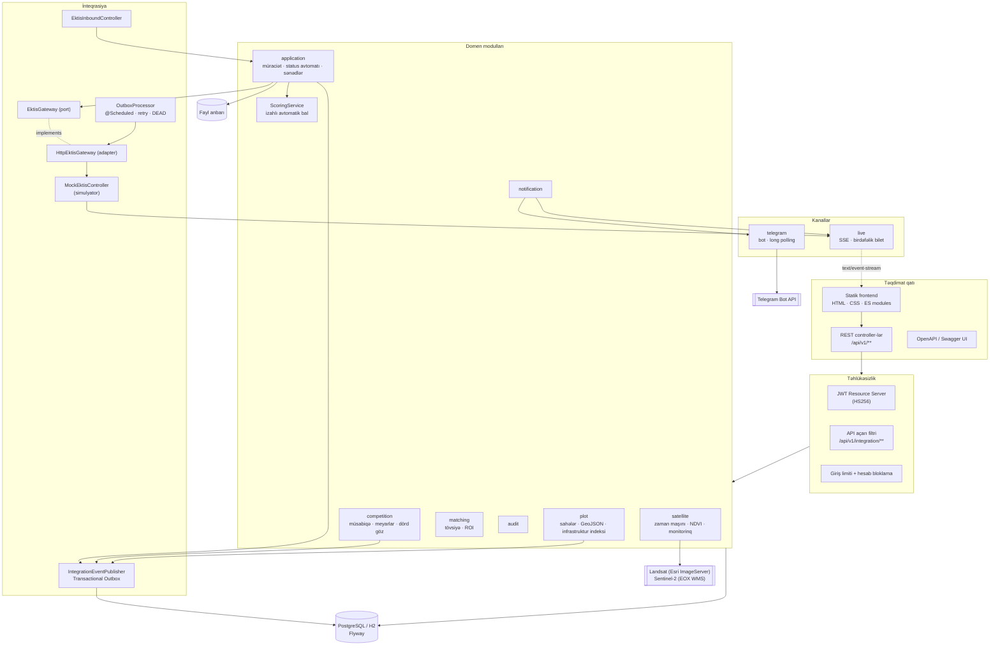
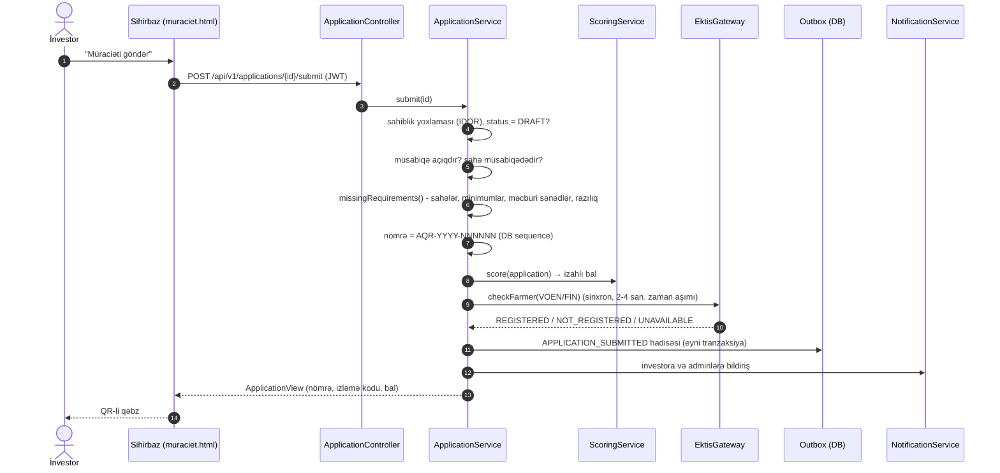
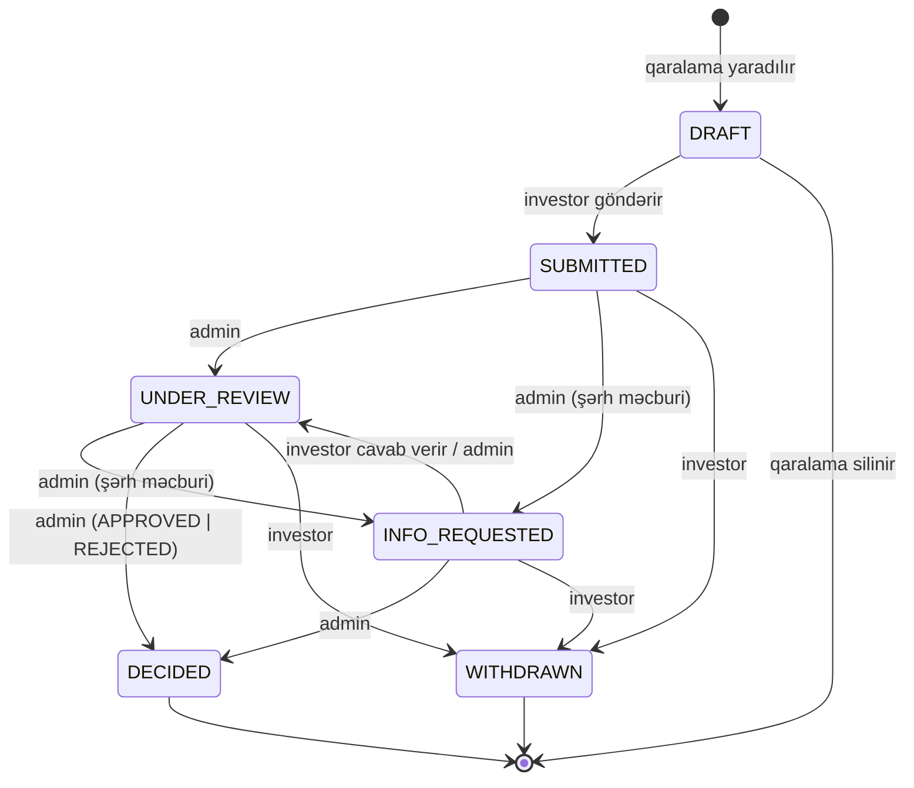
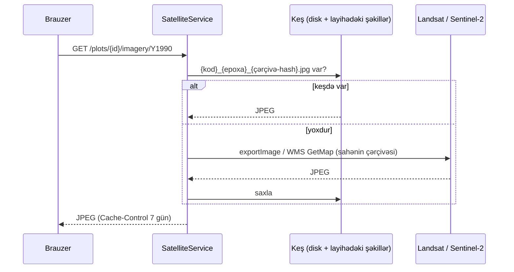
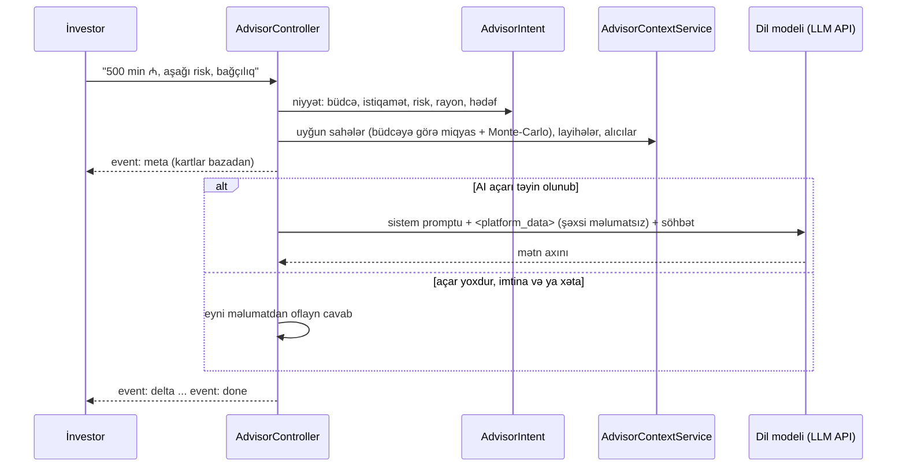
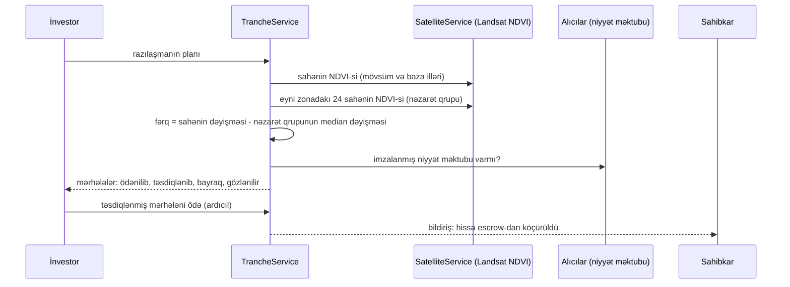

# Arxitektura

## 1. Ümumi yanaşma: modul monolit

Portal **modul monolit** kimi qurulub. Bir yerləşdirmə vahidi (bir JAR) var, amma kod domen sərhədləri üzrə müstəqil paketlərə bölünüb. Səbəblər:

- **Hakaton və pilot mərhələsi üçün sadəlik.** Bir əmrlə işə düşür, bir verilənlər bazası istifadə edir, əməliyyat xərci minimaldır.
- **Gələcəkdə ayrılmağa hazırlıq.** Hər paketin öz entity, repository, servis və controller qatı var. Paketlər bir-biri ilə servis interfeysləri vasitəsilə əlaqələnir. Lazım olduqda `integration`, `notification` və ya `application` ayrıca mikroxidmətə çıxarıla bilər.
- **EKTİS-dən asılılığın təcrid edilməsi.** Biznes məntiqi yalnız `EktisGateway` interfeysini görür (Ports & Adapters). Real EKTİS API-si gələndə yalnız adapter dəyişir.



## 2. Paketlər və məsuliyyətlər

| Paket | Məsuliyyət | Əsas siniflər |
|---|---|---|
| `security` | Autentifikasiya, avtorizasiya, JWT buraxılması, giriş limiti, API açarı, CSP | `SecurityConfig`, `JwtService`, `AuthService`, `ApiKeyAuthFilter`, `LoginRateLimiter` |
| `user` | İstifadəçilər və rollar (INVESTOR, EXPERT, ADMIN) | `User`, `Role`, `AdminUserController` |
| `plot` | Sahələr, filtrlər (JPA Specification), GeoJSON, infrastruktur indeksi, poliqon generatoru | `Plot`, `PlotService`, `PlotSpecifications`, `GeoUtil` |
| `competition` | Müsabiqə həyat dövrü, meyar çəkiləri, "dörd göz" təsdiqi | `Competition`, `CompetitionService`, `Criterion` |
| `application` | Elektron müraciət, status avtomatı, sənədlər, tarixçə, ekspert qiymətləndirməsi, skorinq | `Application`, `ApplicationStatus`, `ApplicationService`, `ScoringService` |
| `matching` | Ağıllı tövsiyə və ROI kalkulyatoru | `RecommendationService`, `RoiService` |
| `integration.ektis` | EKTİS portu və adapteri, outbox, simulyator, sistemlərarası API | `EktisGateway`, `HttpEktisGateway`, `OutboxProcessor`, `EktisInboundController`, `MockEktisController` |
| `document` | Faylların təhlükəsiz saxlanması | `DocumentStorageService` |
| `notification` | İstifadəçi bildirişləri (portal, SSE, Telegram) | `NotificationService` |
| `satellite` | Torpağın zaman maşını, NDVI tarixçəsi, peykdən nəzarət | `SatelliteService`, `ImageryEpoch`, `SatelliteController` |
| `economics` | Torpağın ən yaxşı istifadəsi, Monte-Carlo simulyasiyası, hədəf kalkulyatoru, PVGIS günəş məlumatı | `LandPotentialService`, `MonteCarloService`, `ModelFactory`, `SolarYieldService` |
| `market` | Sahibkar ↔ investor bazarı: layihə, reallıq yoxlaması, investor dili, uyğunlaşdırma, maraq, peyk təsdiqli escrow, AI memorandum | `ProjectService`, `ProjectAnalysisService`, `TrancheService`, `MemoService`, `Project`, `ProjectInterest` |
| `portfolio` | Portfel qurucusu: korrelyasiyalı Monte-Carlo, CVaR optimallaşdırması, səmərəli sərhəd, stress test | `PortfolioService`, `PortfolioController` |
| `impact` | Böyük Qayıdış paneli: rayonlar üzrə potensial, sosial təsir, hazırlıq indeksi | `RegionService`, `Impact` (economics) |
| `buyer` | Alıcı tələbləri, Nazirlik təsdiqi, sahə ilə uyğunlaşdırma, niyyət məktubu | `BuyerService`, `BuyerDemand`, `LetterOfIntent` |
| `advisor` | Əkinçi AI: kontekst, mövzu qoruyucusu (`AdvisorGuard`), LLM şlüzü, oflayn rejim | `LlmGateway`, `AdvisorIntent`, `AdvisorContextService`, `AdvisorService` |
| `live` | Real vaxt yeniləmələri (Server-Sent Events) | `LiveService`, `LiveController` |
| `telegram` | Telegram bildiriş botu (istəyə bağlı) | `TelegramService`, `TelegramController` |
| `audit` | Dəyişməz audit jurnalı | `AuditService` |
| `analytics` | Dashboard statistikası | `StatsController` |
| `seed` | Demo məlumatları | `DemoDataSeeder` |

## 3. Əsas ssenarilər

### 3.1 Müraciətin göndərilməsi



EKTİS əlçatmaz olsa da müraciət **bloklanmır**. Fermer statusu `UNAVAILABLE` kimi qeyd olunur, hadisə isə outbox-da gözləyir.

### 3.2 Status avtomatı



Keçid qaydaları `ApplicationStatus.adminTransitions()` metodunda bir yerdə saxlanılır. İcazəsiz keçid `409 INVALID_TRANSITION` qaytarır. Hər keçid üçün bunlar baş verir:
1. `application_status_history` cədvəlinə kim, nə vaxt və hansı şərhlə qeyd yazılır;
2. investora bildiriş göndərilir;
3. audit jurnalına qeyd düşür;
4. EKTİS üçün `APPLICATION_STATUS_CHANGED` hadisəsi yaranır.

Eyni sahə üzrə ikinci "qalib" qərarı bloklanır (`PLOT_ALREADY_AWARDED`).

### 3.3 Müsabiqənin təsdiqi ("dörd göz")

```mermaid
sequenceDiagram
    actor A1 as Admin 1 (yaradan)
    actor A2 as Admin 2 (təsdiqləyici)
    participant C as CompetitionService
    A1->>C: create() → DRAFT
    A1->>C: submitForApproval() → PENDING_APPROVAL
    C-->>A2: bildiriş "Müsabiqə təsdiq gözləyir"
    A1->>C: approve() ✗ 403 (yaradan təsdiqləyə bilməz)
    A2->>C: approve() → PUBLISHED
    C->>C: sahələr → IN_COMPETITION
    C-->>C: COMPETITION_PUBLISHED hadisəsi (EKTİS)
    C-->>A1: bildiriş; bütün investorlara "yeni müsabiqə"
    A2->>C: reject(qeyd) → DRAFT (alternativ)
```

### 3.4 Avtomatik qiymətləndirmə (skorinq)

Hər meyar üçün 0..1 aralığında **nisbət** hesablanır və müsabiqədə elan olunmuş **çəkiyə** vurulur:

| Meyar (default çəki) | Hesablama |
|---|---|
| İnvestisiya həcmi (25) | minimumdan aşağı: 0.5 × nisbət; minimum = 0.6; minimumun 2 misli = 1.0 |
| Yeni iş yerləri (20) | eyni məntiq, sahənin minimum iş yeri tələbinə görə |
| Biznes plan və təcrübə (15) | təcrübə (10 il = tam) 50% + plan xülasəsinin həcmi 30% + gəlir proqnozu 20% |
| Texnologiya və innovasiya (15) | seçilmiş texnologiyaların balları cəmi / 10 |
| Öz vəsaitinin payı (10) | 60%+ öz vəsaiti tam bal verir |
| Sənədlərin tamlığı (10) | məcburi sənədlər 0.3, əlavə sənədlər 0.13 |
| Sosial təsir (5) | məcburi köçkün / Qarabağ əsilli = 1.0, digərləri = 0.3 |

Nəticə izahla birlikdə (`score_breakdown` JSON) saxlanılır və investora da göstərilir. **Yekun bal = avtomatik × 0.4 + ekspert ortalaması × 0.6**. Qərarı yalnız komissiya verir.

### 3.5 Ağıllı tövsiyə

`RecommendationService` hər sahəni 100 ballıq şkala ilə qiymətləndirir:
- istiqamət uyğunluğu: 30
- büdcə: 25
- ölçü: 15
- rayon: 10
- infrastruktur: 20

Çatışmazlıqlar üçün cərimə tətbiq olunur (suvarma yoxdur, elektrik yoxdur, aktiv müsabiqə yoxdur). Hər nəticə "niyə uyğundur" və "nəyə diqqət edin" siyahıları ilə qaytarılır.

### 3.6 ROI kalkulyatoru

Kateqoriya üzrə istinad göstəriciləri `PlotCategory` enum-unda saxlanılır:
- məhsuldarlıq (t/ha)
- qiymət (₼/t)
- illik xərc və ilkin investisiya (₼/ha)
- bar verməyə qədər olan illər

Bu göstəricilər bonitet balı və suvarma ilə korreksiya olunur. Gəlir yetkinlik illərinə doğru 0% → 50% → 80% → 100% artır. Nəticə 10 illik pul axını, geri ödəmə ili və ROI-dir. Proqnoz təxminidir və bunu interfeysdə də açıq yazırıq.

### 3.7 Torpağın zaman maşını və NDVI



- **Çərçivə** sahənin mərkəzindən serverdə hesablanır (4:3, ən azı 2.6 km), istifadəçi koordinat və ya URL göndərmir.
- **Epoxalar:** Landsat GLS 1990, 2000, 2010 (işğaldan əvvəl və işğal dövrü), Sentinel-2 cloudless 2018 və 2024.
- **NDVI** sahənin poliqonu daxilindəki piksellərin ortasıdır. Hər Landsat 8/9 ili üçün iki mövsüm pəncərəsi (aprel-iyun, iyul-sentyabr) götürülür və ən yaşıl dəyər seçilir.
- **Dürüst müqayisə:** fərqli sensorların dəyərləri bir-biri ilə müqayisə olunmur. Mətn GLS illərini öz aralarında (1990 ilə 2000-2010), Landsat 8/9 illərini isə öz aralarında (2013-2019 ilə 2021+) müqayisə edir. İzah mətni rəqəmlərdən avtomatik qurulur.
- **Peykdən nəzarət:** icarəyə verilmiş sahədə son NDVI 0.25-dən aşağıdırsa sahə "Diqqət tələb edir" kimi qeyd olunur. Heyvandarlıq və arıçılıq sahələrində bu meyar tətbiq edilmir.

### 3.8 Canlı yeniləmələr

1. Brauzer JWT ilə `POST /live/ticket` çağırır və 60 saniyəlik birdəfəlik bilet alır.
2. `EventSource('/api/v1/live/stream?ticket=…')` açılır. Server bileti silir və bağlantını istifadəçi və rol ilə yadda saxlayır.
3. `NotificationService` bildiriş yaradanda `LiveService.toUser(...)` tranzaksiyanın `afterCommit` mərhələsində hadisəni göndərir. Eyni anda bildiriş Telegram-a da gedir (qoşulubsa).
4. Outbox hadisəsi commit olunan kimi `@TransactionalEventListener(AFTER_COMMIT)` prosessoru dərhal işə salır. Planlı 5 saniyəlik dövrü gözləmir. EKTİS simulyatoru hadisəni qəbul və ya rədd edəndə adminlərə `ektis` / `ektis-rejected` hadisəsi gedir.

Ölçülmüş gecikmə (lokal): admin statusu dəyişdikdən sonra investorun ekranı ~0.2 s, EKTİS canlı ekranı ~0.25 s ərzində yenilənir.

### 3.9 Torpağın ən yaxşı istifadəsi və Monte-Carlo

Hər sahə üçün 9 ssenari (6 kənd təsərrüfatı istiqaməti, günəş stansiyası, aqroturizm, soyuducu anbar) iki sualla qiymətləndirilir:

1. **Təyinat və fiziki şərtlər imkan verirmi?** Torpağın hüquqi təyinatı (əkin, çoxillik, otlaq, əkinə yararsız, sənaye), suvarma, elektrik, maillik, hündürlük, yol, mənzərə: uyğunluq balı 0-100 və səbəbləri. Əkin yerində günəş stansiyası "təyinat dəyişikliyi lazımdır" kimi işarələnir.
2. **Pul baxımından nə qədər cəlbedicidir?** 600 ssenarilik Monte-Carlo: geri qayıtma ehtimalı, orta geri qayıtma ili, illik xalis gəlir.

Monte-Carlo modeli hər ssenaridə bunları təsadüfi seçir: məhsuldarlıq (log-normal), təbii şoklar (quraqlıq, şaxta, dolu, xəstəlik: illik ehtimal və itki), bazar qiyməti (orta səviyyəyə qayıdan təsadüfi gəzinti), xərclərin inflyasiyası, tikinti xərcinin artması. Alıcı müqaviləsi həcmin bir hissəsini sabit qiymətə satır və qiymət riskini azaldır. Nəticə: hər il üçün P10-P90 paylanması, xalis bugünkü dəyər, IRR, risk amillərinin korrelyasiyası, il-il "yaşanan" pis, orta və yaxşı ssenari.

Günəş üçün real məlumat: hər sahənin koordinatı üçün Avropa Komissiyasının PVGIS xidmətindən illik istehsal və illər arası dəyişkənlik, Tarif Şurasının 8.5 qəpik/kVts topdansatış tarifi, investisiya Şəfəq GES-in açıqlanmış dəyəri əsasında.

### 3.10 Reallıq yoxlaması və investor dili

Sahibkarın iddiaları (məhsuldarlıq, qiymət, illik gəlir və mənfəət, investisiya) regional istinad göstəriciləri və 1500 ssenarilik simulyasiya ilə müqayisə olunur. Məsələn "ildə 1.2 mln ₼ gəlir" iddiası ssenarilərin neçə faizində mümkündür? Yoxlamaların nəticəsi 0-100 bal və CRIT / WARN / OK siyahısıdır. Sonra investora təklif (pay, borc, gəlirdən pay) simulyasiyanın pis, orta və yaxşı ssenarisində pul axınına çevrilir: investor nə qədər alır, neçə qat, neçənci ildə qayıdır, illik gəlirlilik.

### 3.11 AI məsləhətçi



AI yalnız verilən məlumata əsaslanır, kartlar və rəqəmlər bazadan gəlir. Sual əvvəlcə `AdvisorGuard`-dan keçir: açıq-aşkar kənar sual (kod, şeir, idman, siyasət, təlimatları dəyişmə cəhdi) dil modelinə getmir, qeyri-müəyyən sualı model özü qiymətləndirir və kənardırsa yalnız marker qaytarır, server onu standart imtina ilə əvəz edir. `LlmGateway` dil modeli provayderini konfiqurasiyaya görə seçir: SSE axını, düşüncə hissələri istifadəçiyə göndərilmir, əsas model 503/429 qaytaranda ehtiyat modelə keçid, təhlükəsizlik filtri cavabı kəsəndə oflayn cavab. Provayder adı istifadəçiyə və API cavablarına çıxmır: məhsul "Əkinçi AI" kimi təqdim olunur. Eyni şlüz portfel izahı və investisiya memorandumu üçün də istifadə olunur.

### 3.12 Portfel qurucusu: korrelyasiyalı Monte-Carlo

Tək layihənin simulyasiyası riskin yarısını göstərir: əsl sual budur ki, investisiyalar **eyni anda** pis ola bilərmi? Portfel üçün `MonteCarloService.joint()` bütün variantları ortaq "dünya" ssenarilərində hesablayır. Hər ssenaridə hər il üçün ortaq amillər çəkilir: hava (75% bütün region üçün ortaq, qalanı aran və ya dağlıq zonaya xas), kənd təsərrüfatı bazar qiyməti, turizm tələbi, inflyasiya. Hər investisiyanın bu amillərə həssaslığı var (`Exposure`): taxıl və bağlar havaya güclü bağlıdır, istixana zəif, günəş stansiyası **əks** istiqamətdə (quraq il günəşli ildir), aqroturizm turizm tələbinə. Fərdi amil ortaq amillə `l·F + √(1-l²)·e` kimi qarışdırılır, ona görə hər investisiyanın öz paylanması dəyişmir, yalnız birgə davranışı yaranır. Təbii şoklar (quraqlıq, şaxta, dolu) **Qauss kopulası** ilə: şokun illik ehtimalı saxlanılır, amma pis hava ilində bütün sahələrdə birlikdə baş verir.

Optimallaşdırma: 53 variant × 5 miqyas (kiçik obyektin vahid xərci yüksəkdir, sabit xərclər düzgün nəzərə alınır) × 400 ssenari. Məqsəd funksiyası `E[NPV] - λ·(E[NPV] - CVaR10)`. Acgöz alqoritm hər addımda hər əlavə manata ən çox fayda verən "miqyası artır" addımını seçir, sonra yerli axtarış hər mövqeni çıxarıb pulu yenidən bölməyə çalışır. Məhdudiyyətlər: büdcə, mövqe payı, istiqamət payı, sahənin torpaq ölçüsü (eyni sahədə iki istiqamət sığmalıdır). λ-nın 8 qiyməti səmərəli sərhədi çəkir. Seçilmiş portfel 1000 ssenaridə yenidən hesablanır: pul axını yelpiyi, korrelyasiya matrisi, stress testlər (hadisənin baş verdiyi illər seçilir və gəlir adi illə müqayisə olunur). Namizədlərin simulyasiyası keşdə saxlanılır və tətbiq açılanda fonda hesablanır.

### 3.13 Peyk təsdiqli mərhələli maliyyələşmə



Nəticə bazada saxlanılmır, hər dəfə real məlumatdan hesablanır: yeni mövsümün peyk məlumatı gələn kimi status özü dəyişir. Bazada yalnız investorun etdiyi ödənişlər (`tranche_releases`) saxlanılır. Bitki örtüyü istiqamətlərində dəyişiklik və ya böyümə gözlənilir, tikinti istiqamətlərində (günəş, anbar, istixana) isə əksinə NDVI-nin qonşulara nisbətən azalması.

### 3.14 Böyük Qayıdış paneli və sosial təsir

`Impact` hər modeldən sosial göstəriciləri çıxarır: daimi və dolayı iş yerləri, ailələr (hər daimi iş yeri 0.8 ailə, ailədə 4 nəfər), əmək haqqı fondu, ərzaq (t/il), günəş stansiyası üçün ixraca qalan qaz və CO2 (Qaradağ GES göstəriciləri), bağlar üçün karbon udması. `RegionService` hər rayonda hər sahənin ən uyğun icazəli istiqamətini götürür və hazırlıq indeksini hesablayır: minatəmizləmə 30, infrastruktur 25, iqtisadi potensial 25, bazar marağı 20 (müraciət, layihə, təsdiqlənmiş alıcı tələbi; rayonlar arasında nisbi).

## 4. Dizayn qərarları

| Qərar | Səbəb |
|---|---|
| **Java + Spring Boot** | Texniki tapşırıqda tövsiyə olunub və dövlət sistemlərində geniş yayılıb. OAuth2/JWT, JPA və OpenAPI hazır gəlir |
| **Framework-süz frontend (HTML/CSS/JS)** | Texniki tapşırıqdakı tövsiyəyə uyğundur. Build addımı yoxdur, sürətli yüklənir, internetsiz demo mümkündür. Kitabxanalar lokal saxlanılır |
| **Flyway + `ddl-auto: validate`** | Sxem versiyalanır və həm H2, həm PostgreSQL-də eyni SQL işləyir. Entity ilə sxem uyğunsuzluğu tətbiq başlayanda aşkarlanır |
| **Optimistic locking (`@Version`)** | İki operator eyni müraciəti eyni anda dəyişərsə `409 CONCURRENT_UPDATE` qaytarılır |
| **Transactional Outbox** | Biznes əməliyyatı ilə inteqrasiya hadisəsi atomar olur. Şəbəkə xətası məlumat itkisinə səbəb olmur |
| **JWT (stateless) + OAuth2 Resource Server** | Üfüqi miqyaslama asandır. Gələcəkdə **ASAN Login** və ya Keycloak kimi xarici IdP-yə keçid yalnız konfiqurasiya dəyişikliyi tələb edir (`issuer-uri`) |
| **Enum klassifikatorları + `/api/v1/reference`** | EKTİS klassifikatorları ilə kod səviyyəsində uyğunlaşdırma (mapping) üçün tək mənbə |
| **GeoJSON (EPSG:4326)** | Dövlət CBS sistemləri və Torpaq Kadastrı ilə standart mübadilə formatı |
| **SSE (WebSocket yox)** | Axın bir istiqamətlidir (serverdən brauzerə). SSE adi HTTP üzərində işləyir, proksilərdən keçir, avtomatik yenidən qoşulur və əlavə kitabxana tələb etmir |
| **Peyk şəkilləri serverdə keşlənir** | Kənar xidmət əlçatmaz olsa da demo işləyir. Brauzer kənar domenə sorğu göndərmir, CSP sərt qalır |
| **Telegram üçün long polling** | Webhook ictimai HTTPS ünvan tələb edir. Polling NAT arxasındakı serverdə də işləyir |
| **Simulyasiya tək rəqəm yox, paylanma verir** | Kənd təsərrüfatında risk əsasdır. "ROI 30%" demək investoru aldadır; "ssenarilərin 78%-ində 6 ildə qayıdır, pis ssenaridə -120 min ₼" isə qərar üçün əsasdır. Sabit toxum: eyni sorğu həmişə eyni nəticəni verir |
| **Korrelyasiya ortaq amillərlə, kovariasiya matrisi ilə yox** | 50+ investisiya üçün kovariasiya matrisini ekspert qiymətləndirmək mümkün deyil və ziddiyyətli ola bilər. Bir neçə izah olunan amil (hava zonası, qiymət, turizm, inflyasiya) və həssaslıqlar həmişə ardıcıl korrelyasiya verir və investora izah olunur: "quraq il günəşli ildir" |
| **Peykdə "fərqlərin fərqi"** | Mütləq NDVI həddi yağışlı ildə saxta təsdiq, quraq ildə saxta bayraq verir (2026-cı ildə bütün sahələrin median NDVI-si +0.11 artıb). Qonşu sahələrlə müqayisə hava effektini çıxarır |
| **AI kontekst üçün, hesablama üçün yox** | Rəqəmləri deterministik mühərriklər (Monte-Carlo, reallıq yoxlaması) hesablayır, AI yalnız onları investor dilində izah edir. Buna görə AI olmadan da (oflayn rejim) platforma tam işləyir |

## 5. Miqyaslama yolu

1. **Pilot:** tək instansiya + PostgreSQL (indiki vəziyyət). SSE bağlantıları instansiyanın yaddaşında saxlanılır.
2. **Üfüqi miqyas:** bir neçə instansiya load balancer arxasında. Bunun üçün iki dəyişiklik lazımdır:
   - giriş limitini Redis-ə köçürmək;
   - outbox prosessorunu `SELECT … FOR UPDATE SKIP LOCKED` ilə paylanmış etmək;
   - canlı hadisələri instansiyalar arasında Redis Pub/Sub və ya PostgreSQL `LISTEN/NOTIFY` ilə yaymaq.
3. **Fayllar:** `DocumentStorageService` S3/MinIO adapteri ilə əvəz olunur.
4. **Mikroxidmətlər:** `integration` modulu ayrıca xidmətə çıxarılır. Outbox Kafka/RabbitMQ-ya Debezium CDC ilə ötürülür.
