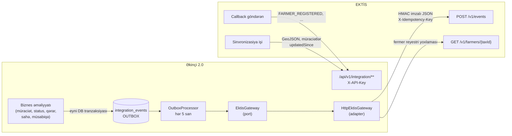

# EKTİS inteqrasiya konsepsiyası

> Texniki tapşırıqda bu hissə "**hakatonun ən mühüm texniki hissəsi**" adlandırılıb. Aşağıda göstərilir ki, portal Kənd Təsərrüfatı Nazirliyinin Elektron Kənd Təsərrüfatı İnformasiya Sistemi (EKTİS) ilə **real inteqrasiyaya hazırdır**. Hakatonda real EKTİS əvəzinə eyni protokolla işləyən **simulyator** istifadə olunur.

## 1. Tapşırıqdakı tələblərin qarşılanması

| Tələb | Həll | Kod |
|---|---|---|
| **1. API-yə hazırlıq** | 2 istiqamətli REST API: Portal → EKTİS (imzalı hadisələr) və EKTİS → Portal (`/api/v1/integration/**`). Hər iki istiqamət **işləyir**, simulyasiya deyil | `HttpEktisGateway`, `EktisInboundController` |
| **2. Məlumat modeli** | Sahibkar, sahə, müsabiqə və müraciət obyektləri strukturlaşdırılıb. Mübadilə formatı versiyalanıb (`schemaVersion: 1.0`) | [MELUMAT-MODELI.md](MELUMAT-MODELI.md) |
| **3. Təhlükəsizlik** | API açarı (sabit-zamanlı müqayisə), HMAC-SHA256 imza, vaxt damğası (replay qorunması), idempotentlik açarı, rollar, şəxsi məlumatların minimallaşdırılması | `ApiKeyAuthFilter`, `MockEktisController` |
| **4. Modul arxitektura** | Ports & Adapters: biznes məntiqi yalnız `EktisGateway` interfeysindən asılıdır. Adapter konfiqurasiya ilə dəyişir | `integration/ektis` paketi |
| **5. Sənədləşdirmə** | Bu sənəd, OpenAPI 3.1 spesifikasiyası, curl nümunələri, admin panelində canlı monitorinq | [openapi.json](openapi.json) |

## 2. Ümumi sxem



## 3. Portal → EKTİS: hadisələr (push)

### 3.1 Hadisə kataloqu

| Hadisə | Nə vaxt yaranır | `data` sahəsində |
|---|---|---|
| `APPLICATION_SUBMITTED` | İnvestor müraciəti göndərəndə | nömrə, müsabiqə, sahə, rayon, müraciətçi növü və adı, VÖEN/FİN, fəaliyyət, investisiya, iş yerləri, avtomatik bal |
| `APPLICATION_STATUS_CHANGED` | Hər status keçidində | nömrə, `from`, `to`, vaxt |
| `APPLICATION_DECIDED` | Qərar veriləndə | nömrə, qərar, sahə kodu, investisiya, iş yerləri, VÖEN/FİN |
| `COMPETITION_PUBLISHED` | Müsabiqə təsdiqlənib dərc ediləndə | kod, başlıq, tarixlər, sahə kodları |
| `COMPETITION_CLOSED` | Müsabiqə bağlananda | kod |
| `PLOT_CREATED` / `PLOT_UPDATED` | Sahə əlavə və ya redaktə ediləndə | kod, ad, rayon, ölçü, təyinat |

### 3.2 Zərf (envelope) formatı

```json
{
  "eventId": "8b1d5c0e-4f7a-4c55-9a6e-1e1f0f0c2a11",
  "eventType": "APPLICATION_SUBMITTED",
  "schemaVersion": "1.0",
  "source": "aqroinvest-qarabag",
  "occurredAt": "2026-10-14T11:29:41.512Z",
  "aggregate": { "type": "Application", "id": "23" },
  "data": {
    "applicationNumber": "AQR-2026-000022",
    "status": "SUBMITTED",
    "competitionCode": "MSB-2026-01",
    "plotCode": "AGD-004",
    "district": "AGDAM",
    "applicantType": "LEGAL",
    "applicantName": "Test Aqro MMC",
    "taxId": "1234567890",
    "activityType": "BAGCILIQ",
    "investmentAmount": 1200000,
    "jobsPlanned": 42,
    "autoScore": 75,
    "submittedAt": "2026-10-14T11:29:41.488Z",
    "applicantUserId": 2,
    "plotAreaHa": 60.0,
    "plotGeometry": {
      "type": "Polygon",
      "coordinates": [[[46.919129, 39.955559], [46.917351, 39.95756], [46.912933, 39.9587],
                       [46.909052, 39.956985], [46.906779, 39.953989], [46.919129, 39.955559]]]
    }
  }
}
```

`plotGeometry` sahənin sərhədidir (GeoJSON, EPSG:4326, `[uzunluq, enlik]`): EKTİS sahəni öz torpaq reyestri ilə koordinatla tutuşdura bilir. `applicantUserId` portal istifadəçisinin identifikatorudur, `taxId` isə FİN və ya VÖEN.

**Canlı nümayiş (iki ekran):** solda portalda müraciət göndərilir, sağda admin panelində **EKTİS canlı ekranı** açıqdır: hadisə saniyəsində imzalı JSON kimi EKTİS simulyatoruna düşür (`/mock/ektis/v1/events`), simulyatorun cavabı (`202 Accepted`, istinad nömrəsi) və təkrar cəhdlər həmin ekranda görünür. Postman və ya terminalla da yoxlamaq olar: `GET /api/v1/admin/integration/events` (admin tokeni ilə).

### 3.3 HTTP sorğusu

```http
POST {EKTIS_BASE_URL}/v1/events
Content-Type: application/json
X-API-Key: <portalın EKTİS-dəki açarı>
X-Client-System: aqroinvest-qarabag
X-Event-Type: APPLICATION_SUBMITTED
X-Idempotency-Key: 8b1d5c0e-4f7a-4c55-9a6e-1e1f0f0c2a11
X-Timestamp: 2026-10-14T11:29:42.001Z
X-Signature: sha256=HMAC_SHA256(secret, X-Timestamp + "." + body)
```

Gözlənilən cavab `202 Accepted { "reference": "EKTIS-2026-1022" }`. EKTİS-in verdiyi istinad nömrəsi müraciətdə saxlanılır (`ektis_reference`) və investora göstərilir.

### 3.4 Etibarlılıq: Transactional Outbox və retry

```mermaid
sequenceDiagram
    participant S as ApplicationService
    participant DB as DB (tranzaksiya)
    participant P as OutboxProcessor
    participant E as EKTİS
    S->>DB: UPDATE applications ... ; INSERT integration_events (PENDING)
    Note over S,DB: COMMIT - hər ikisi yazılır, ya da heç biri
    loop hər 5 saniyə
        P->>DB: PENDING/FAILED və next_attempt_at <= now (25 ədəd)
        P->>E: POST /v1/events (imzalı)
        alt 2xx
            E-->>P: reference
            P->>DB: status=SENT, external_ref, sent_at
        else xəta / zaman aşımı / 5xx
            P->>DB: status=FAILED, attempts++, next_attempt_at = now + 5·2^(n-1) san
        end
    end
    Note over P,DB: 6 cəhddən sonra DEAD → admin panelindən "Yenidən göndər"
```

- **Atomarlıq:** hadisə biznes məlumatı ilə eyni tranzaksiyada yazılır. "Müraciət saxlanıldı, amma EKTİS-ə xəbər getmədi" vəziyyəti yaranmır.
- **Ən azı bir dəfə çatdırılma + idempotentlik:** təkrar göndərmə mümkündür. Qəbul edən tərəf `X-Idempotency-Key` ilə dublikatı tanıyır (simulyator bunu edir: `duplicate: true`).
- **Eksponensial gecikmə:** 5 → 10 → 20 → 40 → 80 san. Bundan sonra `DEAD` statusu verilir və admin xəbərdar olur.
- **Müşahidə:** admin panelində "EKTİS inteqrasiyası" bölməsi var. Orada çatdırılma statistikası, gecikmə, hər hadisənin payload-ı, xəta mətni, əl ilə retry və "növbəni indi göndər" düyməsi görünür.

### 3.5 Sinxron yoxlama: fermer reyestri

Müraciət göndəriləndə portal VÖEN və ya FİN üzrə `GET /v1/farmers/{taxId}` sorğusu ilə EKTİS fermer reyestrini yoxlayır. Zaman aşımı: bağlantı üçün 2 san, oxuma üçün 4 san. Nəticə (`REGISTERED`, `NOT_REGISTERED` və ya `UNAVAILABLE`) müraciətdə saxlanılır və komissiyaya göstərilir. EKTİS əlçatmazdırsa müraciət **bloklanmır**. Admin yoxlamanı paneldən təkrarlaya bilər.

## 4. EKTİS → Portal: sistemlərarası API (pull + callback)

Bütün sorğular `X-API-Key` başlığı tələb edir. Səhv və ya boş açar `401 INVALID_API_KEY` qaytarır.

| Metod | Yol | Təyinat |
|---|---|---|
| `GET` | `/api/v1/integration/plots` | Bütün sahələr - **GeoJSON FeatureCollection** (EPSG:4326, poliqonlar) |
| `GET` | `/api/v1/integration/competitions` | Müsabiqələr, meyarlar, sahələr |
| `GET` | `/api/v1/integration/applications?status=&updatedSince=` | Müraciətlər, **artımlı sinxronizasiya** üçün dəyişmə tarixinə görə |
| `GET` | `/api/v1/integration/applications/{number}` | Bir müraciət |
| `POST` | `/api/v1/integration/callbacks` | EKTİS bildirişi: məs. `FARMER_REGISTERED`. Müraciətin tarixçəsinə yazılır, investora bildiriş gedir |

```bash
curl -H "X-API-Key: ektis-demo-api-key-2026" \
  "http://localhost:8080/api/v1/integration/applications?updatedSince=2026-10-01T00:00:00Z"

curl -X POST -H "X-API-Key: ektis-demo-api-key-2026" -H "Content-Type: application/json" \
  -d '{"applicationNumber":"AQR-2026-000003","type":"FARMER_REGISTERED","reference":"EKTIS-FRM-77812","message":"Fermer reyestrinə daxil edildi"}' \
  http://localhost:8080/api/v1/integration/callbacks
```

## 5. Klassifikatorların uyğunlaşdırılması

Portal öz kodlarını (`AGDAM`, `BAGCILIQ`, `SUBMITTED` ...) `GET /api/v1/reference` ilə açıq şəkildə verir. Real inteqrasiyada EKTİS-in rəsmi kodları ilə **mapping cədvəli** adapter səviyyəsində əlavə olunur. Domen modeli dəyişmir.

| Portal kodu | EKTİS ekvivalenti (nümunə, dəqiqləşdiriləcək) |
|---|---|
| `District.AGDAM` | İnzibati ərazi vahidi kodu (AZ-AGM) |
| `PlotCategory.EKINCILIK` | Fəaliyyət növü: bitkiçilik / dənli bitkilər |
| `ApplicationStatus.DECIDED + APPROVED` | Müqavilə hazırlığı mərhələsi |

## 6. Simulyatordan real EKTİS-ə keçid planı

1. **Konfiqurasiya.** Mühit dəyişənlərini təyin edin:
   ```
   EKTIS_BASE_URL=https://<ektis-host>/api
   EKTIS_API_KEY=<Nazirliyin verdiyi açar>
   EKTIS_HMAC_SECRET=<paylaşılan sirr>
   ```
2. **Autentifikasiya.** EKTİS OAuth2 client-credentials və ya mTLS tələb edirsə, `HttpEktisGateway` daxilində `RestClient` interceptor əlavə olunur. İnterfeys dəyişmir.
3. **Mapping.** Klassifikatorlar üçün `EktisCodeMapper` komponenti yazılır.
4. **Sxem razılaşdırması.** Hadisə zərfinin `schemaVersion` sahəsi ilə versiyalanır. Uyğunsuzluq olarsa `v2` paralel dəstəklənir.
5. **Sınaq mühiti.** Əvvəlcə EKTİS-in test mühiti (staging) ilə, sonra pilot rejimində 1 müsabiqə ilə.
6. **Simulyatorun söndürülməsi.** `/mock/ektis/**` controller-i `@Profile("!prod")` ilə yalnız test mühitlərində qalır.

> **Qeyd:** Texniki tapşırığa uyğun olaraq real EKTİS-ə qoşulma yalnız səlahiyyətli qurumun razılığı və texniki şərtləri əsasında həyata keçirilməlidir.

## 7. Simulyatorun davranışı (demo üçün)

| Xüsusiyyət | Necə nümayiş olunur |
|---|---|
| API açarının yoxlanması | Açarsız sorğu `401` alır |
| HMAC imzasının yoxlanması | Səhv imza `401` alır; admin panelində "etibarsız imza" sayğacı var |
| Replay qorunması | 5 dəqiqədən köhnə `X-Timestamp` rədd edilir |
| İdempotentlik | Eyni `X-Idempotency-Key` təkrar emal olunmur (`duplicate: true`) |
| Nasazlıq simulyasiyası | Sorğuların 15%-i `503` alır (`EKTIS_MOCK_FAILURE_RATE`). Retry canlı görünür |
| Fermer reyestri | VÖEN/FİN üzrə deterministik nəticə (~60% `REGISTERED`) |
| **Canlı qəbul ekranı** | `/ektis-canli.html` (admin) EKTİS tərəfini təsvir edir: qəbul edilən hər hadisə imza nəticəsi və JSON zərfi ilə ~0.25 s ərzində görünür. `503` və yanlış imza ilə rədd edilən cəhdlər qırmızı sətirlə çıxır, bir neçə saniyə sonra outbox-un təkrar göndərdiyi hadisə gəlir. Ekran SSE ilə işləyir, səhifəni yeniləmək lazım deyil |
