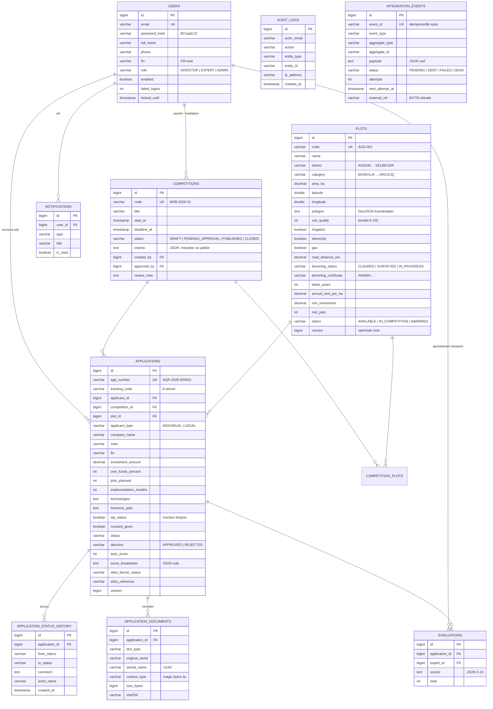
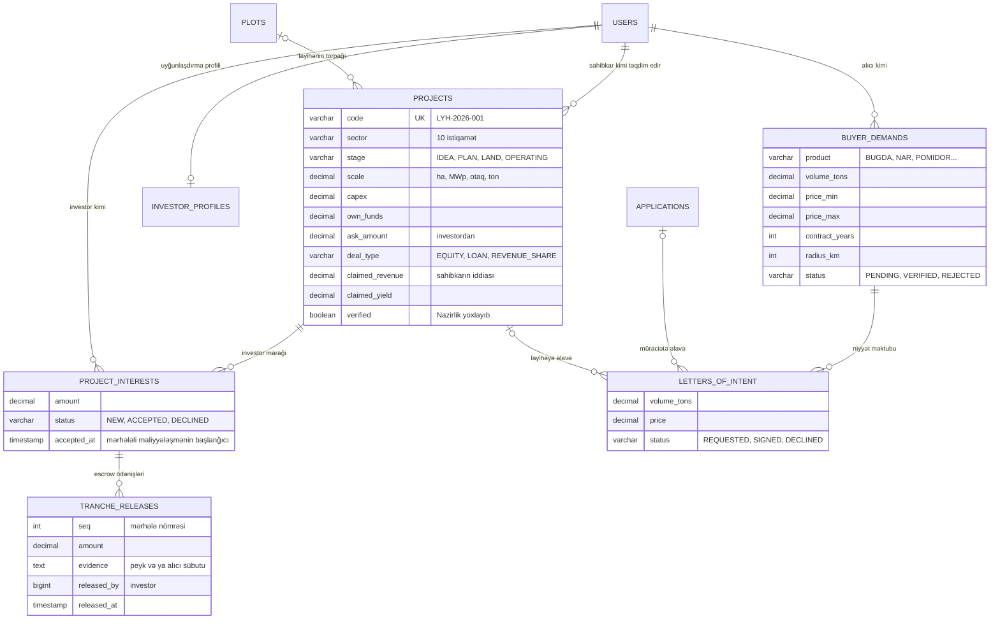
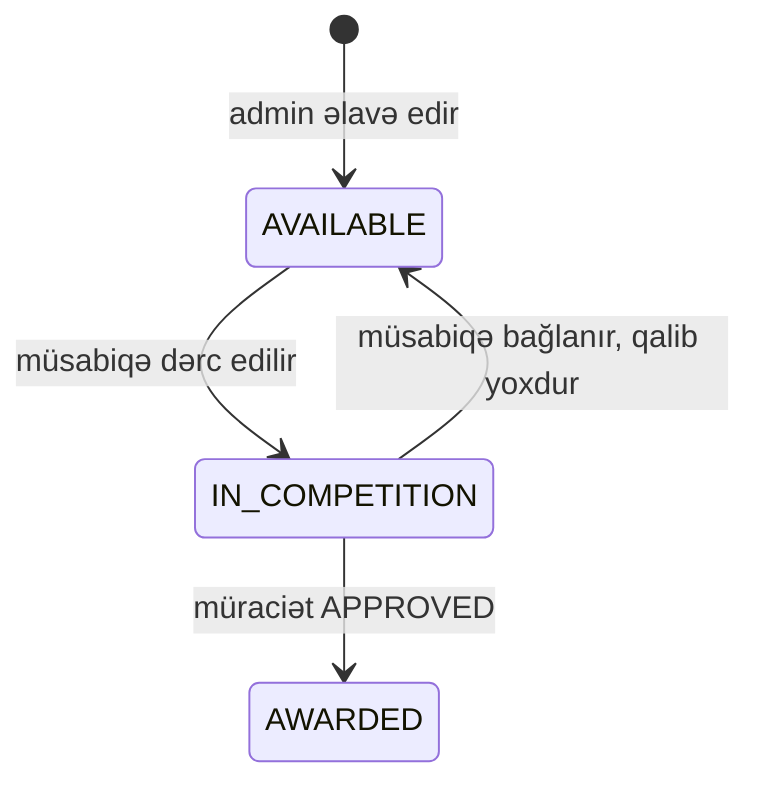
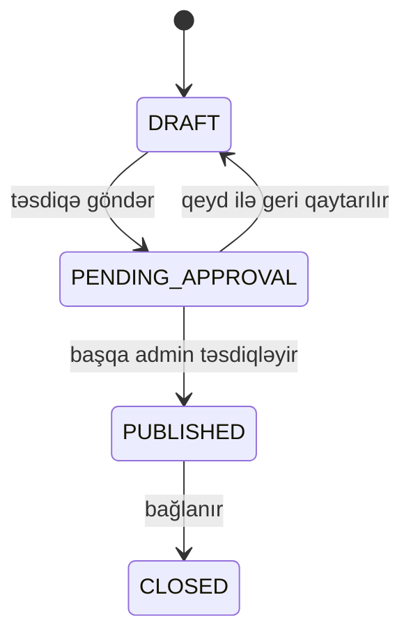

# Məlumat modeli

Texniki tapşırıqda tələb olunan dörd əsas obyekt **sahibkar, təsərrüfat sahəsi, müsabiqə və müraciət** strukturlaşdırılıb. Ətrafında tarixçə, sənədlər, qiymətləndirmə, bildiriş, audit və inteqrasiya (outbox) cədvəlləri qurulub.

Sxem Flyway ilə versiyalanır: [`V1__init_schema.sql`](../src/main/resources/db/migration/V1__init_schema.sql) (əsas sxem), [`V2__telegram.sql`](../src/main/resources/db/migration/V2__telegram.sql), [`V3__land_designation.sql`](../src/main/resources/db/migration/V3__land_designation.sql) (torpaq təyinatı), [`V4__marketplace.sql`](../src/main/resources/db/migration/V4__marketplace.sql) (sahibkar ↔ investor bazarı, alıcılar). SQL həm **PostgreSQL 16**, həm də **H2 (PostgreSQL rejimi)** üzərində eyni işləyir.

## ER diaqramı

## Bazar modulu: sahibkar, investor, alıcı

- **Əlaqə məlumatlarının məxfiliyi:** `project_interests` statusu `ACCEPTED` olana qədər nə investor sahibkarın, nə sahibkar investorun telefon və e-poçtunu görür.
- **Reallıq yoxlaması saxlanılmır, hər dəfə hesablanır:** iddialar (`claimed_*`) dəyişdikcə və ya istinad göstəriciləri yeniləndikcə nəticə avtomatik dəyişir (layihənin versiyası üzrə keşlənir).
- **Təsdiqlənmiş tələb** (`VERIFIED`) zəmanət deyil: alıcının real ehtiyacının Nazirlik tərəfindən yoxlandığını göstərir.
- **Mərhələlərin statusu saxlanılmır, hər dəfə real məlumatdan hesablanır** (`V5__tranches.sql`): peyk mərhələləri Landsat NDVI seriyasından (sahə və eyni zonadakı nəzarət sahələri), alıcı mərhələsi imzalanmış niyyət məktubundan. Bazada yalnız investorun etdiyi ödənişlər (`tranche_releases`) saxlanılır, `(interest_id, seq)` unikaldır: eyni hissə iki dəfə ödənilə bilməz.
- **Portfel və Böyük Qayıdış paneli bazaya yazmır:** sahələrdən, layihələrdən və alıcı tələblərindən hesablanır, portfel namizədlərinin simulyasiyası sahələrin versiyası üzrə yaddaşda keşlənir.

## Klassifikatorlar

Bütün klassifikatorlar kod və ad cütü şəklində `GET /api/v1/reference` ilə verilir. EKTİS-in rəsmi kodları ilə uyğunlaşdırma (mapping) cədvəli bu ünvan əsasında qurulur.

| Klassifikator | Dəyərlər |
|---|---|
| Rayon (`District`) | AGDAM, FUZULI, XOCAVEND, XOCALI, SUSA, TERTER (Qarabağ); CEBRAYIL, ZENGILAN, QUBADLI, LACIN, KELBECER (Şərqi Zəngəzur) |
| Fəaliyyət istiqaməti (`PlotCategory`) | EKINCILIK, HEYVANDARLIQ, BAGCILIQ, UZUMCULUK, ISTIXANA, ARICILIQ |
| Torpağın hüquqi təyinatı (`LandDesignation`) | EKIN (əkin yeri), COXILLIK (çoxillik əkmələr), OTLAQ (otlaq və biçənək), YARARSIZ (əkinə yararsız: şoran, daşlı, eroziyalı), SENAYE (sənaye və digər) |
| İstifadə ssenarisi (`UseCase`) | 6 kənd təsərrüfatı istiqaməti + GUNES (günəş stansiyası), AQROTURIZM, SOYUDUCU (anbar və emal) |
| Layihə istiqaməti (`ProjectSector`) | yuxarıdakılar + ENERJI, TURIZM, EMAL, AQROTEXNOLOGIYA |
| Rol | INVESTOR (investor / sahibkar), BUYER (alıcı), EXPERT, ADMIN |
| Minatəmizləmə | CLEARED, SURVEYED, IN_PROGRESS |
| Sahənin statusu | AVAILABLE, IN_COMPETITION, AWARDED |
| Müsabiqənin statusu | DRAFT, PENDING_APPROVAL, PUBLISHED, CLOSED |
| Müraciətin statusu | DRAFT, SUBMITTED (*Qəbul edilib*), UNDER_REVIEW (*Baxılır*), INFO_REQUESTED (*Əlavə məlumat tələb olunur*), DECIDED (*Qərar verilib*), WITHDRAWN |
| Qərar | APPROVED, REJECTED |
| Sənəd növü | BUSINESS_PLAN\*, IDENTITY\*, TAX_CERTIFICATE, BANK_REFERENCE, EXPERIENCE_PROOF, ADDITIONAL (\* məcburi) |
| Texnologiyalar | DRIP_IRRIGATION, SOLAR, IOT_SENSORS, DRONES, COLD_STORAGE, ORGANIC, PROCESSING, CLIMATE_CONTROL, PRECISION_AG, WATER_RECYCLING |

## Sahənin həyat dövrü

## Müsabiqənin həyat dövrü

## Bütövlük qaydaları

- Bir investorun eyni müsabiqədə eyni sahə üçün yalnız bir aktiv müraciəti ola bilər (`DUPLICATE_APPLICATION`).
- Bir sahə üzrə yalnız bir müraciət `APPROVED` ola bilər (`PLOT_ALREADY_AWARDED`).
- Müraciəti olan və ya müsabiqəyə daxil edilmiş sahə silinə bilməz.
- Meyar çəkilərinin cəmi 100 olmalıdır (`CRITERIA_WEIGHT`).
- Müraciət nömrələri DB sequence (`application_number_seq`) ilə yaradılır, yarış şəraitində də unikal qalır.
- `plots` və `applications` cədvəlləri `version` sütunu ilə optimistic locking istifadə edir.

## İndekslər

`plots(district)`, `plots(category)`, `plots(status)`, `competitions(status)`, `applications(applicant_id)`, `applications(competition_id)`, `applications(status)`, `application_status_history(application_id)`, `notifications(user_id, is_read)`, `audit_logs(created_at)`, `integration_events(status, next_attempt_at)`.
